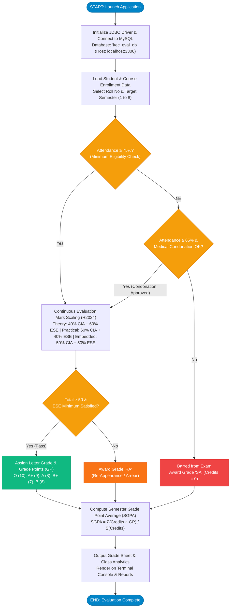
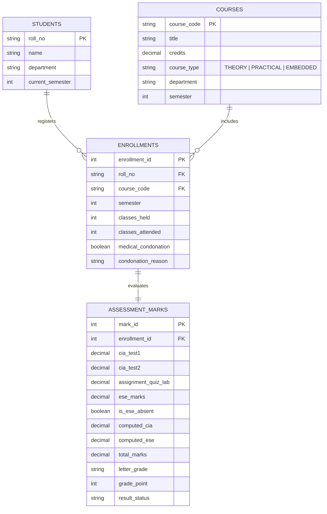
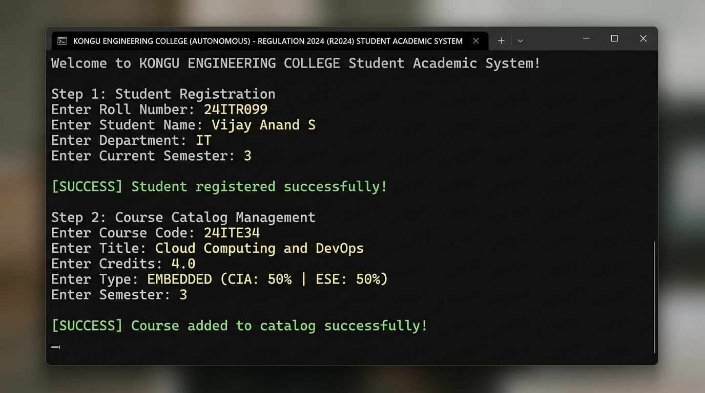
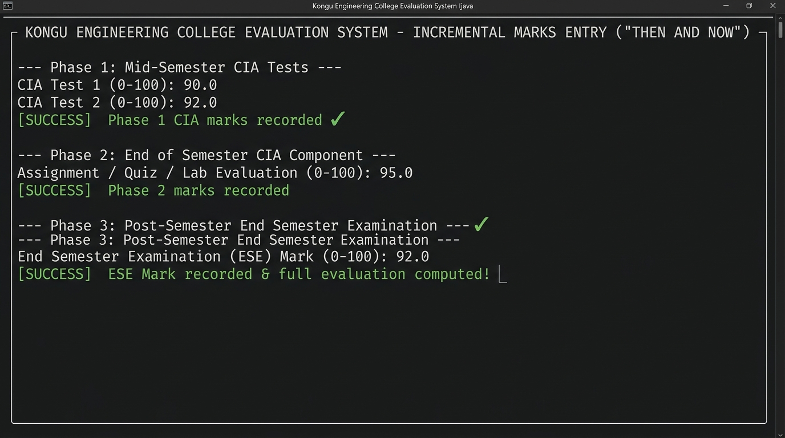
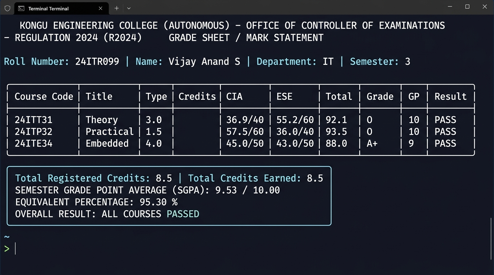

# Kongu Engineering College (Autonomous), Perundurai - 638060
## Department of Information Technology
### 24ITT32 - PROGRAMMING IN JAVA
# Individual Project on Academic Management System
### Regulation 2024 (R2024) - Student Academic & Continuous Evaluation System
**Submitted by:** **VETRISELVAN K** (Roll No: **25ITR170**)  
**Repository:** [https://github.com/vetriselvank25it/Java-jdbc.git](https://github.com/vetriselvank25it/Java-jdbc.git)

---

[](https://www.oracle.com/java/)
[](https://dev.mysql.com/downloads/connector/j/)
[](https://www.mysql.com/)
[](https://github.com/vetriselvank25it/Java-jdbc)
[](https://github.com/vetriselvank25it/Java-jdbc/raw/main/PROJECT_REPORT.pdf)

---

## 📥 Project Report PDF - Direct Download

| Access Method | Link / Action | Details |
| :--- | :--- | :--- |
| 🚀 **Direct Download (One-Click)** | [**Download Project Report PDF (Root)**](https://github.com/vetriselvank25it/Java-jdbc/raw/main/PROJECT_REPORT.pdf) | Direct raw download link from GitHub repository |
| 📂 **Mirror Download Link (Docs)** | [**Download from Docs Folder**](https://github.com/vetriselvank25it/Java-jdbc/raw/main/docs/PROJECT_REPORT.pdf) | Mirrored direct download link in `docs/` |
| 👁️ **View on GitHub (Web Viewer)** | [**Open PDF in GitHub Browser**](https://github.com/vetriselvank25it/Java-jdbc/blob/main/PROJECT_REPORT.pdf) | View directly inside GitHub's integrated PDF reader |
| 📝 **Markdown Documentation** | [**View Detailed PROJECT_REPORT.md**](docs/PROJECT_REPORT.md) | Full technical breakdown, math formulas, and report text |

---

## 📋 Project Synopsis

### 🎯 AIM
Development of **Kongu Engineering College (Autonomous) - Regulation 2024 (R2024)** Student Academic & Continuous Evaluation System using **Java JDBC**.

### 📌 OBJECTIVE
Design and develop a database-driven Java application using **JDBC** to manage student records, perform incremental marks entry (Continuous Internal Assessments and End Semester Examinations), enforce attendance eligibility rules, and generate formal academic performance reports according to **Kongu Engineering College (Autonomous) - Regulation 2024** System Requirements & Specifications.

---

## 🔄 System Flowchart

The operational workflow follows the statutory evaluation roadmap of Kongu Engineering College Regulation 2024:



---

## 📝 Step-by-Step Implementation Procedure

1. **Load JDBC Driver:** Load the MySQL Connector/J driver (`com.mysql.cj.jdbc.Driver`) to enable communication between the Java application and the MySQL / MariaDB database server.
2. **Establish Database Connection:** Establish a connection to the `kec_eval_db` database running on the local MySQL server using `DriverManager.getConnection()`.
3. **Student & Course Management:** Store and retrieve student details, including roll number, name, department, and semester, along with course information such as course code, title, credits, and course type (`THEORY`, `PRACTICAL`, or `EMBEDDED`).
4. **Course Enrollment & Attendance Tracking:** Enroll students in semester courses, record the number of classes held and attended, and calculate the attendance percentage.
5. **Enforce Attendance Eligibility Rules:** Verify examination eligibility based on attendance percentage:
   - **$\ge 75\%$:** Fully eligible for End Semester Examination (ESE).
   - **$65\% - 74\%$:** Require approved medical condonation verification.
   - **$< 65\%$:** Automatically marked as **Shortage of Attendance (SA)** and barred from examination.
6. **Incremental Continuous Assessments ("Then and Now"):** Record CIA-1, CIA-2, and assignment/quiz/lab marks incrementally, and calculate the scaled continuous internal assessment marks according to course category weightages.
7. **End Semester Examination (ESE) Scoring:** Record end-semester examination marks out of 100 or mark as absent (`AB`), verify the minimum passing requirements, and scale the marks according to applicable course weightage.
8. **Final Mark & Grade Computation:** Calculate total marks by combining scaled CIA and ESE marks. Assign letter grades (`O`, `A+`, `A`, `B+`, `B`, `RA`, `SA`, `AB`) and grade points (0 to 10), marking students as **RA** if they fail the examination threshold or score below the passing minimum.
9. **Academic Reports Generation:** Generate student grade sheets, attendance shortage defaulter reports, and department-wise pass percentage reports. Display the results through interactive console menus and formatted CLI summaries.

---

## 🛠️ Technology Stack

| Component | Technology | Version | Description |
| :--- | :--- | :--- | :--- |
| **Language** | Java (OpenJDK / Oracle JDK) | 17+ / 21+ / 26 | Core application logic, OOP entity models, and calculation engine |
| **Database API** | JDBC (Java Database Connectivity) | 4.2 | Database access layer utilizing `Connection`, `PreparedStatement`, and `ResultSet` |
| **Database Server** | MySQL / MariaDB | 8.0+ / 10.4+ | Relational database management system with UTF-8 support |
| **JDBC Driver** | MySQL Connector/J | 8.3.0 | Type 4 pure Java driver for database communication (`lib/mysql-connector-j-8.3.0.jar`) |
| **Design Pattern** | DAO (Data Access Object) | MVC / Clean OOP | Decoupled Model, DAO, DB Engine, and Presentation layers |
| **Automation** | Windows Batch Scripting | .bat | One-click build (`compile.bat`), launch (`run.bat`), and test suite (`run_demo.bat`) |
| **Platform** | Cross-Platform | Windows / Linux / macOS | Platform-independent Java bytecode execution |

---

## 📐 KEC R2024 Evaluation Rules & Weightage Engine

### 1. Course Classification & Weightage Proportions
Kongu Engineering College Regulation 2024 splits courses into three distinct categories with custom continuous internal assessment (CIA) and end semester examination (ESE) distributions:

| Course Category | CIA Weightage | ESE Weightage | ESE Minimum Threshold | Overall Passing Minimum |
| :--- | :---: | :---: | :---: | :---: |
| **THEORY** | **40%** | **60%** | $\ge 45\%$ ($27.0 / 60$ scaled) | **50.0 Marks** |
| **PRACTICAL** | **60%** | **40%** | $\ge 50\%$ ($20.0 / 40$ scaled) | **50.0 Marks** |
| **EMBEDDED** | **50%** | **50%** | $\ge 45\%$ ($22.5 / 50$ scaled) | **50.0 Marks** |

### 2. Phased Continuous Assessment Workflow ("Then and Now")
Assessment marks entry is decoupled into 3 distinct phases to simulate real-world academic semesters:
- **Phase 1 (Mid-Semester):** Records `cia_test1` (0–100) and `cia_test2` (0–100).
- **Phase 2 (End-of-Semester CIA):** Records `assignment_quiz_lab` (0–100).
- **Phase 3 (Post-Semester ESE):** Records `ese_marks` (0–100) or flags student as absent (`is_ese_absent`).

$$\text{CIA}_{100} = (0.35 \times \text{CIA}_1) + (0.35 \times \text{CIA}_2) + (0.30 \times \text{Assignment})$$
$$\text{Scaled CIA} = \text{CIA}_{100} \times \left(\frac{\text{CIA Weightage}}{100}\right)$$
$$\text{Scaled ESE} = \text{ESE}_{100} \times \left(\frac{\text{ESE Weightage}}{100}\right)$$
$$\text{Total Marks} = \text{Scaled CIA} + \text{Scaled ESE}$$

### 3. Statutory Attendance & 10-Point Grading Scale
- **$\ge 75.0\%$ Attendance:** Eligible for ESE.
- **$65.0\% - 74.9\%$ Attendance:** Conditionally eligible. Requires approved **Medical Condonation**. If not approved, student is barred from ESE ($\to \text{SA}$).
- **$< 65.0\%$ Attendance:** Shortage of Attendance. Mandatorily awarded **SA** grade (0 Grade Points). Barred from ESE.

| Range of Marks | Letter Grade | Grade Point (GP) | Status / Result |
| :---: | :---: | :---: | :---: |
| **91 – 100** | **O** | **10** | Outstanding (Pass) |
| **81 – 90** | **A+** | **9** | Excellent (Pass) |
| **71 – 80** | **A** | **8** | Very Good (Pass) |
| **61 – 70** | **B+** | **7** | Good (Pass) |
| **50 – 60** | **B** | **6** | Average (Pass) |
| **< 50 or Failed ESE Min** | **RA** | **0** | Re-Appearance (Fail) |
| **Shortage of Attendance (<65%)** | **SA** | **0** | Barred / Disqualified |
| **Absent in ESE Exam** | **AB** | **0** | Absent (Fail) |

### 4. SGPA & Equivalent Percentage Formulas
$$\text{SGPA} = \frac{\sum (\text{Course Credits} \times \text{Grade Points Earned})}{\sum \text{Total Registered Credits}}$$
$$\text{Equivalent Percentage (\%)} = \text{SGPA} \times 10$$

---

## 🗄️ Database Architecture & Schema

### Entity-Relationship Diagram (ERD)


---

## 📁 Project Directory Layout

```
KEC_R2024_Academic_System/
│
├── compile.bat                             # One-click Java batch compiler
├── run.bat                                 # Interactive console launcher
├── run_demo.bat                            # Automated end-to-end verification suite
├── README.md                               # Complete project documentation & guide
├── PROJECT_REPORT.pdf                      # Official Academic Project Report (PDF)
│
├── lib/
│   └── mysql-connector-j-8.3.0.jar         # MySQL JDBC Driver library
│
├── sql/
│   └── kec_schema.sql                      # Complete DDL schema and sample seed records
│
├── bin/                                    # Compiled Java bytecode (.class files)
│   └── com/kec/eval/
│       ├── model/
│       ├── db/
│       ├── engine/
│       ├── dao/
│       └── app/
│
├── docs/
│   ├── PROJECT_REPORT.md                   # Full academic project documentation
│   ├── Academic_Management_System_Project_Report.pdf # Project report PDF (Official)
│   ├── KEC_R2024_Academic_System_Project_Report.pdf # Project report PDF (Mirror)
│   └── screenshots/                        # High-resolution execution proofs
│       ├── 1_student_course_registration.jpg
│       ├── 2_incremental_marks_entry.jpg
│       └── 3_grade_sheet_sgpa.jpg
│
├── output/                                 # Verification screenshots & MySQL table captures
│   ├── student table.png
│   ├── Course table.png
│   ├── Enrollments tabel.png
│   ├── Assessment marks table.png
│   └── Screenshot 2026-10-26 *.png
│
└── src/                                    # Java source code
    └── com/kec/eval/
        ├── model/                          # Entity & Data Transfer Models
        │   ├── Student.java                # Student profile model
        │   ├── Course.java                 # Course catalog model
        │   ├── CourseType.java             # Course category enum (THEORY, etc.)
        │   ├── Enrollment.java             # Enrollment & attendance model
        │   ├── AssessmentMark.java         # Marks evaluation model
        │   ├── CourseResult.java           # Formatted course grade result line
        │   ├── StudentSemesterResult.java  # Grade sheet & SGPA performance model
        │   └── ClassSummary.java           # Department analytics summary model
        ├── db/
        │   └── DBConnection.java           # JDBC Connection pool & auto-bootstrap
        ├── engine/
        │   └── EvaluationEngine.java       # Pure R2024 evaluation logic & math rules
        ├── dao/
        │   ├── StudentDAO.java             # CRUD operations for student records
        │   └── AcademicDAO.java            # Catalog, enrollments, marks & reporting DAO
        └── app/
            ├── MainApp.java                # Interactive CLI menu application
            └── TestSimulation.java         # Automated verification test suite
```

---

## ⚙️ Prerequisites & Database Setup

### 1. Requirements:
- **Java Development Kit (JDK):** Version 17, 21, or newer installed and added to `PATH`.
- **Database Server:** MySQL Server 8.0+ or MariaDB 10.4+ (e.g., via **XAMPP**, **WAMP**, or standalone MySQL).
- **Default Database Configuration (`src/com/kec/eval/db/DBConnection.java`):**
  - **URL:** `jdbc:mysql://localhost:3306/kec_eval_db?createDatabaseIfNotExist=true&useSSL=false&allowPublicKeyRetrieval=true`
  - **Username:** `root`
  - **Password:** ` ` *(empty by default for XAMPP)*

### 2. Database Initialization:
The application **automatically creates** the database `kec_eval_db` and all required tables upon first launch!

If you prefer to manually initialize the database with seed data:
```bash
# Open terminal / command prompt in project root
mysql -u root -p < sql/kec_schema.sql
```
*(Or import `sql/kec_schema.sql` using phpMyAdmin or MySQL Workbench).*

---

## 🚀 How to Run (Running Commands)

### Method 1: One-Click Execution (Windows Batch Scripts) - Recommended
Simply double-click the pre-configured Windows batch files:
- 🟢 **`run.bat`**: Launches the **Interactive Menu-Driven Console Application**.
- 🔵 **`run_demo.bat`**: Runs the **Automated End-to-End Simulation** that validates all test scenarios, attendance condonations, and grade sheet calculations.
- 🟡 **`compile.bat`**: Re-compiles all Java source code files into `bin/`.

---

### Method 2: Command Line (CLI / Terminal)

#### Step 1: Open Terminal in Project Root
```bash
cd C:\Users\VETRISELVAN\Desktop\KEC_R2024_Academic_System
```

#### Step 2: Compile Java Source Files
```bash
# Windows Command Prompt / PowerShell
javac -d bin -cp "bin;lib/mysql-connector-j-8.3.0.jar" src/com/kec/eval/model/*.java src/com/kec/eval/db/*.java src/com/kec/eval/engine/*.java src/com/kec/eval/dao/*.java src/com/kec/eval/app/*.java

# Linux / macOS (colon-separated classpath)
javac -d bin -cp "bin:lib/mysql-connector-j-8.3.0.jar" src/com/kec/eval/model/*.java src/com/kec/eval/db/*.java src/com/kec/eval/engine/*.java src/com/kec/eval/dao/*.java src/com/kec/eval/app/*.java
```

#### Step 3: Run Interactive Application (`MainApp`)
```bash
# Windows
java -cp "bin;lib/mysql-connector-j-8.3.0.jar" com.kec.eval.app.MainApp

# Linux / macOS
java -cp "bin:lib/mysql-connector-j-8.3.0.jar" com.kec.eval.app.MainApp
```

#### Step 4: Run Automated Verification Suite (`TestSimulation`)
```bash
# Windows
java -cp "bin;lib/mysql-connector-j-8.3.0.jar" com.kec.eval.app.TestSimulation

# Linux / macOS
java -cp "bin:lib/mysql-connector-j-8.3.0.jar" com.kec.eval.app.TestSimulation
```

---

## 📊 Sample Academic Outputs

### 1. Official Student Grade Sheet
```text
============================================================================================================
                       KONGU ENGINEERING COLLEGE (AUTONOMOUS)                                               
                             OFFICE OF CONTROLLER OF EXAMINATIONS                                           
                     REGULATION 2024 (R2024) - GRADE SHEET / MARK STATEMENT                                 
============================================================================================================
 Roll Number  : 24ITR099        | Name       : Vijay Anand S                      
 Department   : IT              | Semester   : 3     | Academic Batch: 2024-2028
------------------------------------------------------------------------------------------------------------
Course    | Course Title                     | Type      | Cred | Att(%) | CIA Mark  | ESE Mark  | Total  | Grade | GP  | Result    
------------------------------------------------------------------------------------------------------------
24ITE34   | Cloud Computing and DevOps       | EMBEDDED  | 4.0  | 90.0 % | 45.0/50   | 43.0/50   | 88.0   | A+    | 9   | PASS      
24ITP32   | Object Oriented Programming Lab  | PRACTICAL | 1.5  | 90.0 % | 57.5/60   | 36.0/40   | 93.5   | O     | 10  | PASS      
24ITT31   | Database Management Systems      | THEORY    | 3.0  | 94.0 % | 36.9/40   | 55.2/60   | 92.1   | O     | 10  | PASS      
============================================================================================================
 Total Registered Credits : 8.5    | Total Credits Earned : 8.5   
 SEMESTER GRADE POINT AVERAGE (SGPA) :  9.53 / 10.00
 EQUIVALENT PERCENTAGE               : 95.30 %
 OVERALL SEMESTER RESULT             : ALL COURSES PASSED
============================================================================================================
```

### 2. Statutory Attendance Defaulter Report (Grade SA)
```text
--------------------------------------------------------------------------------------------------------------
Roll No    | Student Name       | Dept  | Course   | Course Title                 | Held  | Attn  | Attn %  | Action/Status
--------------------------------------------------------------------------------------------------------------
24ITR003   | Chandru M          | IT    | 24ITT31  | Database Management Systems  | 50    | 28    | 56.0  % | Barred (<65% SA)
24ITR003   | Chandru M          | IT    | 24ITP32  | Object Oriented Java Lab     | 30    | 20    | 66.7  % | No Condonation (SA)
--------------------------------------------------------------------------------------------------------------
```

### 3. Department Result Analytics Summary
```text
------------------------------------------------------------------------------------------------------
Dept     | Students | Enrollments  | Passed   | RA(Arrear) | SA     | AB     | Pass %     | Avg SGPA  
------------------------------------------------------------------------------------------------------
CSE      | 1        | 1            | 1        | 0        | 0      | 0      | 100.00   % | 9.00      
ECE      | 1        | 1            | 1        | 0        | 0      | 0      | 100.00   % | 8.00      
IT       | 5        | 15           | 11       | 1        | 2      | 1      | 73.33    % | 6.56      
------------------------------------------------------------------------------------------------------
```

---

## 📸 Execution Proofs & Screenshots

### Proof 1: Student Registration & Course Catalog


### Proof 2: Incremental Marks Entry ("Then and Now")


### Proof 3: Official KEC R2024 Grade Sheet with SGPA


### Proof 4: Relational Database Tables in MySQL
| Students Table | Courses Table |
| :---: | :---: |
|  |  |

| Enrollments Table | Assessment Marks Table |
| :---: | :---: |
|  |  |

---

## 🏆 RESULT

> **Thus, the Student Academic and Continuous Evaluation System for Kongu Engineering College (Autonomous) Regulation 2024 was successfully designed, developed, and tested using Java (JDBC) and MySQL. The system accurately automates the calculation of Continuous Internal Assessments (CIA), End Semester Examinations (ESE), Letter Grades, Attendance Eligibility, and Semester Grade Point Average (SGPA).**

---

## 📚 REFERENCES

1. **Oracle**, *Java SE Documentation – JDBC Overview and Architecture*. [https://docs.oracle.com/javase/8/docs/technotes/guides/jdbc/](https://docs.oracle.com/javase/8/docs/technotes/guides/jdbc/)
2. **Oracle**, *Java SE API – HttpServer*. [https://docs.oracle.com/en/java/javase/17/docs/api/jdk.httpserver/com/sun/net/httpserver/HttpServer.html](https://docs.oracle.com/en/java/javase/17/docs/api/jdk.httpserver/com/sun/net/httpserver/HttpServer.html)
3. **Oracle**, *MySQL 8.0 Reference Manual*. [https://dev.mysql.com/doc/refman/8.0/en/](https://dev.mysql.com/doc/refman/8.0/en/)
4. **Oracle**, *MySQL Connector/J Developer Guide*. [https://dev.mysql.com/doc/connector-j/8.0/en/](https://dev.mysql.com/doc/connector-j/8.0/en/)
5. **University Grants Commission (UGC)**, *Guidelines for Choice Based Credit System (CBCS)*. [https://www.ugc.gov.in/pdfnews/8023719_Guidelines-for-CBCS.pdf](https://www.ugc.gov.in/pdfnews/8023719_Guidelines-for-CBCS.pdf)
6. **Chart.js**, *Chart.js Documentation*. [https://www.chartjs.org/docs/latest/](https://www.chartjs.org/docs/latest/)
7. **Tailwind CSS**, *Tailwind CSS Documentation*. [https://tailwindcss.com/docs](https://tailwindcss.com/docs)
8. **GeeksforGeeks**, *Establishing JDBC Connection in Java*. [https://www.geeksforgeeks.org/establishing-jdbc-connection-in-java/](https://www.geeksforgeeks.org/establishing-jdbc-connection-in-java/)
9. **YouTube**, *Java JDBC with MySQL Tutorial Videos*. [https://www.youtube.com/results?search_query=Java+JDBC+MySQL+tutorial](https://www.youtube.com/results?search_query=Java+JDBC+MySQL+tutorial)
10. **Anthropic**, *Claude AI Assistant* (used for project ideas and guidance). [https://claude.ai/](https://claude.ai/)

---

## 👨‍💻 Author & Academic Submission

- **Student Name:** VETRISELVAN K
- **Roll Number:** 25ITR170
- **Department:** Department of Information Technology
- **Course:** 24ITT32 - Programming in Java
- **Project Type:** Individual Project on Academic Management System
- **Institution:** [Kongu Engineering College (Autonomous)](https://kongu.ac.in/), Perundurai, Erode - 638060, Tamil Nadu, India
- **GitHub Repository:** [https://github.com/vetriselvank25it/Java-jdbc.git](https://github.com/vetriselvank25it/Java-jdbc.git)

---
*Developed with ❤️ and engineering rigor for academic excellence.*
