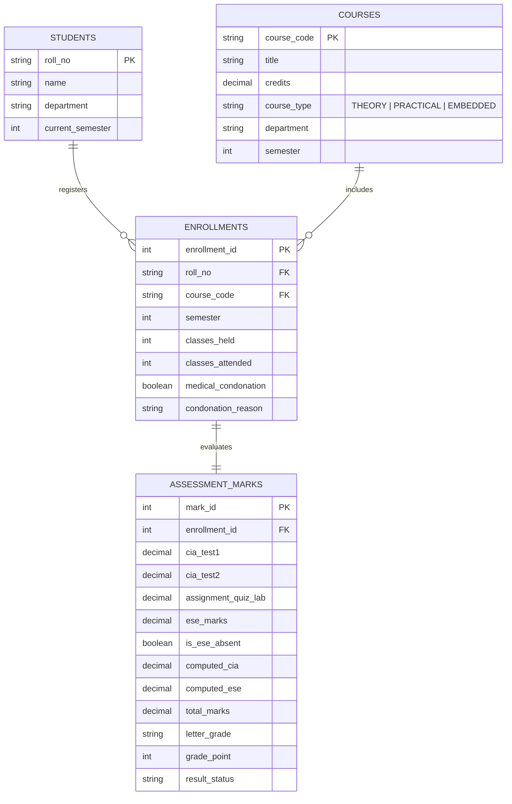

# Kongu Engineering College (Autonomous), Perundurai - 638060
## Regulation 2024 (R2024) - Student Academic & Continuous Evaluation System
### Enterprise Java JDBC & Relational Database Application

[](https://www.oracle.com/java/)
[](https://dev.mysql.com/downloads/connector/j/)
[](https://www.mysql.com/)
[](https://github.com/vetriselvank25it/Java-jdbc)
[](https://github.com/vetriselvank25it/Java-jdbc/raw/main/docs/KEC_R2024_Academic_System_Project_Report.pdf)

---

## 📥 Project PDF Report - Direct Download

You can access and download the formal academic project documentation and execution report directly using any of the following links:

| Access Method | Link / Action | Details |
| :--- | :--- | :--- |
| 🚀 **Direct Download (One-Click)** | [**Download Project Report PDF**](https://github.com/vetriselvank25it/Java-jdbc/raw/main/docs/KEC_R2024_Academic_System_Project_Report.pdf) | Direct raw download link from GitHub repository (`docs/`) |
| 👁️ **View on GitHub (Web Viewer)** | [**Open PDF in GitHub Browser**](https://github.com/vetriselvank25it/Java-jdbc/blob/main/docs/KEC_R2024_Academic_System_Project_Report.pdf) | View directly inside GitHub's integrated PDF reader |
| 📝 **Markdown Documentation** | [**View Detailed PROJECT_REPORT.md**](docs/PROJECT_REPORT.md) | Full technical breakdown, math formulas, and report text |

---

## 📖 Table of Contents
1. [About the Project](#-about-the-project)
2. [Key System Features](#-key-system-features)
3. [Technology Stack](#-technology-stack)
4. [KEC R2024 Regulation & Evaluation Engine](#-kec-r2024-regulation--evaluation-engine)
5. [Database Architecture & Schema](#-database-architecture--schema)
6. [Project Directory Layout](#-project-directory-layout)
7. [Prerequisites & Database Setup](#-prerequisites--database-setup)
8. [How to Run (Running Commands)](#-how-to-run-running-commands)
9. [Sample Academic Outputs](#-sample-academic-outputs)
10. [Execution Proofs & Screenshots](#-execution-proofs--screenshots)
11. [Author & Academic Credits](#-author--academic-credits)

---

## 💡 About the Project

The **KEC R2024 Academic & Continuous Evaluation System** is an enterprise-grade, database-driven Java application built using **Java Database Connectivity (JDBC)**. Developed specifically to adhere to the statutory academic norms of **Kongu Engineering College (Autonomous), Perundurai - Regulation 2024 (R2024)**, this system automates end-to-end examination administration, incremental ("Then and Now") continuous internal assessments (CIA), statutory attendance validation with condonation processing, and semester grade sheet generation.

### Core Objectives:
- **Comprehensive Academic Records:** Maintain unified relational records of students, course offerings, credit catalogs, and semester enrollments.
- **Phased Continuous Assessment ("Then and Now"):** Allow incremental entry of marks across mid-semester tests, assignments/lab work, and final end-semester examinations.
- **Dynamic Weightage Computations:** Automatically switch evaluation rules and passing thresholds based on course classification (`THEORY`, `PRACTICAL`, or `EMBEDDED`).
- **Statutory Attendance Enforcement:** Programmatically enforce the 75% attendance rule, process medical condonations for 65%–74.9%, and award mandatory **SA** (Shortage of Attendance) grades for unexcused defaulters.
- **Official R2024 10-Point Absolute Grading:** Calculate course letter grades, grade points, Semester Grade Point Average (SGPA), and Equivalent Percentage according to the official R2024 formula.

---

## ✨ Key System Features

- 🛡️ **Robust DAO Architecture:** Clean separation of concerns with Model-DAO design, zero business logic inside UI, and pure SQL interactions via `PreparedStatement`.
- 🔒 **ACID Compliance & Injection Prevention:** 100% parameterized SQL queries preventing SQL Injection attacks and ensuring database integrity with foreign key cascade actions.
- 🔄 **Self-Initializing Database:** Automatically checks connection status and bootstraps tables on application startup if they do not exist.
- 📊 **Department & Class Analytics:** Generates department-wide summary statistics, enrollment totals, pass percentages, and average SGPA metrics.
- 🚫 **Defaulter & Arrear Tracking:** Automated identification of students barred due to attendance shortage (`SA`), examination absentees (`AB`), and reappearance candidates (`RA`).
- ⚡ **Dual Execution Modes:** Includes an interactive menu-driven CLI (`MainApp`) for administrators as well as an automated simulation suite (`TestSimulation`) for instant end-to-end verification.

---

## 🛠️ Technology Stack

| Component | Technology | Version | Description |
| :--- | :--- | :--- | :--- |
| **Language** | Java (OpenJDK / Oracle JDK) | 17+ / 21+ / 26 | Core application logic, OOP models, and calculation engine |
| **Database API** | JDBC (Java Database Connectivity) | 4.2 | Database access layer utilizing `Connection`, `PreparedStatement`, and `ResultSet` |
| **Database Server** | MySQL / MariaDB | 8.0+ / 10.4+ | Relational database management system with UTF-8 support |
| **JDBC Driver** | MySQL Connector/J | 8.3.0 | Type 4 pure Java driver for database communication |
| **Architecture Pattern** | DAO / Separation of Concerns | Clean OOP | Distinct Model, DAO, DB Engine, and Presentation layers |
| **Automation** | Windows Batch Scripting | .bat | One-click build, launch, and automated verification scripts |
| **Platform** | Cross-Platform | Windows / Linux / macOS | Platform-independent Java bytecode execution |

---

## 📐 KEC R2024 Regulation & Evaluation Engine

### 1. Course Classification & Weightage Rules
Kongu Engineering College Regulation 2024 splits courses into three categories, each having unique evaluation proportions:

| Course Category | CIA Weightage | ESE Weightage | ESE Passing Threshold | Overall Passing Minimum |
| :--- | :---: | :---: | :---: | :---: |
| **THEORY** | **40%** | **60%** | $\ge 45\%$ ($27.0 / 60$ scaled) | **50.0 Marks** |
| **PRACTICAL** | **60%** | **40%** | $\ge 50\%$ ($20.0 / 40$ scaled) | **50.0 Marks** |
| **EMBEDDED** | **50%** | **50%** | $\ge 45\%$ ($22.5 / 50$ scaled) | **50.0 Marks** |

### 2. Phased Incremental Assessment ("Then and Now")
Continuous assessment is entered incrementally across three distinct stages of the academic semester:

```
[Phase 1: Mid-Semester]          [Phase 2: End-of-Semester CIA]         [Phase 3: ESE Examination]
  CIA Test 1 (0-100)               Assignment / Quiz / Lab (0-100)        End Semester Exam (0-100)
  CIA Test 2 (0-100)                              │                                   │
          │                                       │                                   │
          ▼                                       ▼                                   ▼
  Normalized CIA (100) = (CIA_1 × 0.35) + (CIA_2 × 0.35) + (Assignment × 0.30)
  Scaled CIA           = Normalized CIA × (CIA_Weightage / 100)
  Scaled ESE           = Raw ESE × (ESE_Weightage / 100)
  Total Course Marks   = Scaled CIA + Scaled ESE
```

### 3. Statutory Attendance & Eligibility Rules
- **$\ge 75.0\%$ Attendance:** Fully eligible to appear for End Semester Examinations (ESE).
- **$65.0\% - 74.9\%$ Attendance:** Conditionally eligible. Requires approved **Medical Condonation**. If not approved, the student is barred from ESE and awarded grade **SA**.
- **$< 65.0\%$ Attendance:** Shortage of Attendance. Mandatorily barred from ESE, awarded grade **SA** (0 Grade Points). Must re-register for the course in subsequent semesters.

### 4. 10-Point Absolute Grading System
| Range of Marks | Letter Grade | Grade Point (GP) | Qualitative Result |
| :---: | :---: | :---: | :---: |
| **91 – 100** | **O** | **10** | Outstanding (Pass) |
| **81 – 90** | **A+** | **9** | Excellent (Pass) |
| **71 – 80** | **A** | **8** | Very Good (Pass) |
| **61 – 70** | **B+** | **7** | Good (Pass) |
| **50 – 60** | **B** | **6** | Average (Pass) |
| **< 50 or Failed ESE Min** | **RA** | **0** | Re-Appearance (Fail) |
| **Shortage of Attendance (<65%)** | **SA** | **0** | Barred / Disqualified |
| **Absent in ESE Exam** | **AB** | **0** | Absent (Fail) |

### 5. Academic Performance Formulas
- **Semester Grade Point Average (SGPA):**
  $$\text{SGPA} = \frac{\sum (\text{Course Credits} \times \text{Grade Points Earned})}{\sum \text{Total Registered Credits}}$$
- **Equivalent Percentage Calculation:**
  $$\text{Equivalent Percentage (\%)} = \text{SGPA} \times 10$$

---

## 🗄️ Database Architecture & Schema

### Entity-Relationship Diagram (ERD)


---

## 📁 Project Directory Layout

```
KEC_R2024_Academic_System/
│
├── compile.bat                             # One-click Java batch compiler
├── run.bat                                 # Interactive console launcher
├── run_demo.bat                            # Automated end-to-end verification suite
├── README.md                               # Complete project documentation & guide
│
├── lib/
│   └── mysql-connector-j-8.3.0.jar         # MySQL JDBC Driver library
│
├── sql/
│   └── kec_schema.sql                      # Complete DDL schema and sample seed records
│
├── bin/                                    # Compiled Java bytecode (.class files)
│   └── com/kec/eval/
│       ├── model/
│       ├── db/
│       ├── engine/
│       ├── dao/
│       └── app/
│
├── docs/
│   ├── PROJECT_REPORT.md                   # Full academic report document
│   ├── KEC_R2024_Academic_System_Project_Report.pdf # Project report PDF
│   └── screenshots/                        # High-resolution execution proofs
│       ├── 1_student_course_registration.jpg
│       ├── 2_incremental_marks_entry.jpg
│       └── 3_grade_sheet_sgpa.jpg
│
├── output/                                 # Verification screenshots & MySQL table captures
│   ├── student table.png
│   ├── Course table.png
│   ├── Enrollments tabel.png
│   ├── Assessment marks table.png
│   └── Screenshot 2026-10-26 *.png
│
└── src/                                    # Java source code
    └── com/kec/eval/
        ├── model/                          # Entity & Data Transfer Models
        │   ├── Student.java                # Student profile model
        │   ├── Course.java                 # Course catalog model
        │   ├── CourseType.java             # Course category enum (THEORY, etc.)
        │   ├── Enrollment.java             # Enrollment & attendance model
        │   ├── AssessmentMark.java         # Marks evaluation model
        │   ├── CourseResult.java           # Formatted course grade result line
        │   ├── StudentSemesterResult.java  # Grade sheet & SGPA performance model
        │   └── ClassSummary.java           # Department analytics summary model
        ├── db/
        │   └── DBConnection.java           # JDBC Connection pool & auto-bootstrap
        ├── engine/
        │   └── EvaluationEngine.java       # Pure R2024 evaluation logic & math rules
        ├── dao/
        │   ├── StudentDAO.java             # CRUD operations for student records
        │   └── AcademicDAO.java            # Catalog, enrollments, marks & reporting DAO
        └── app/
            ├── MainApp.java                # Interactive CLI menu application
            └── TestSimulation.java         # Automated verification test suite
```

---

## ⚙️ Prerequisites & Database Setup

### 1. Requirements:
- **Java Development Kit (JDK):** Version 17, 21, or newer installed and added to `PATH`.
- **Database Server:** MySQL Server 8.0+ or MariaDB 10.4+ (e.g., via **XAMPP**, **WAMP**, or standalone MySQL).
- **Default Database Configuration (`src/com/kec/eval/db/DBConnection.java`):**
  - **URL:** `jdbc:mysql://localhost:3306/kec_eval_db`
  - **Username:** `root`
  - **Password:** ` ` *(empty by default for XAMPP)*

### 2. Database Initialization:
The application **automatically creates** the database `kec_eval_db` and all required tables upon first launch!

If you prefer to manually initialize the database with seed data:
```bash
# Open terminal / command prompt in project root
mysql -u root -p < sql/kec_schema.sql
```
*(Or import `sql/kec_schema.sql` using phpMyAdmin or MySQL Workbench).*

---

## 🚀 How to Run (Running Commands)

### Method 1: One-Click Execution (Windows Batch Scripts) - Recommended
Simply double-click the pre-configured Windows batch files:
- 🟢 **`run.bat`**: Launches the **Interactive Menu-Driven Console Application**.
- 🔵 **`run_demo.bat`**: Runs the **Automated End-to-End Simulation** that validates all test scenarios, attendance condonations, and grade sheet calculations.
- 🟡 **`compile.bat`**: Re-compiles all Java source code files into `bin/`.

---

### Method 2: Command Line (CLI / Terminal)

#### Step 1: Open Terminal in Project Root
```bash
cd C:\Users\VETRISELVAN\Desktop\KEC_R2024_Academic_System
```

#### Step 2: Compile Java Source Files
```bash
# Windows Command Prompt / PowerShell
javac -d bin -cp "bin;lib/mysql-connector-j-8.3.0.jar" src/com/kec/eval/model/*.java src/com/kec/eval/db/*.java src/com/kec/eval/engine/*.java src/com/kec/eval/dao/*.java src/com/kec/eval/app/*.java

# Linux / macOS (colon-separated classpath)
javac -d bin -cp "bin:lib/mysql-connector-j-8.3.0.jar" src/com/kec/eval/model/*.java src/com/kec/eval/db/*.java src/com/kec/eval/engine/*.java src/com/kec/eval/dao/*.java src/com/kec/eval/app/*.java
```

#### Step 3: Run Interactive Application (`MainApp`)
```bash
# Windows
java -cp "bin;lib/mysql-connector-j-8.3.0.jar" com.kec.eval.app.MainApp

# Linux / macOS
java -cp "bin:lib/mysql-connector-j-8.3.0.jar" com.kec.eval.app.MainApp
```

#### Step 4: Run Automated Verification Suite (`TestSimulation`)
```bash
# Windows
java -cp "bin;lib/mysql-connector-j-8.3.0.jar" com.kec.eval.app.TestSimulation

# Linux / macOS
java -cp "bin:lib/mysql-connector-j-8.3.0.jar" com.kec.eval.app.TestSimulation
```

---

## 📊 Sample Academic Outputs

### 1. Official Student Grade Sheet
```text
============================================================================================================
                       KONGU ENGINEERING COLLEGE (AUTONOMOUS)                                               
                             OFFICE OF CONTROLLER OF EXAMINATIONS                                           
                     REGULATION 2024 (R2024) - GRADE SHEET / MARK STATEMENT                                 
============================================================================================================
 Roll Number  : 24ITR099        | Name       : Vijay Anand S                      
 Department   : IT              | Semester   : 3     | Academic Batch: 2024-2028
------------------------------------------------------------------------------------------------------------
Course    | Course Title                     | Type      | Cred | Att(%) | CIA Mark  | ESE Mark  | Total  | Grade | GP  | Result    
------------------------------------------------------------------------------------------------------------
24ITE34   | Cloud Computing and DevOps       | EMBEDDED  | 4.0  | 90.0 % | 45.0/50   | 43.0/50   | 88.0   | A+    | 9   | PASS      
24ITP32   | Object Oriented Programming Lab  | PRACTICAL | 1.5  | 90.0 % | 57.5/60   | 36.0/40   | 93.5   | O     | 10  | PASS      
24ITT31   | Database Management Systems      | THEORY    | 3.0  | 94.0 % | 36.9/40   | 55.2/60   | 92.1   | O     | 10  | PASS      
============================================================================================================
 Total Registered Credits : 8.5    | Total Credits Earned : 8.5   
 SEMESTER GRADE POINT AVERAGE (SGPA) :  9.53 / 10.00
 EQUIVALENT PERCENTAGE               : 95.30 %
 OVERALL SEMESTER RESULT             : ALL COURSES PASSED
============================================================================================================
```

### 2. Statutory Attendance Defaulter Report (Grade SA)
```text
--------------------------------------------------------------------------------------------------------------
Roll No    | Student Name       | Dept  | Course   | Course Title                 | Held  | Attn  | Attn %  | Action/Status
--------------------------------------------------------------------------------------------------------------
24ITR003   | Chandru M          | IT    | 24ITT31  | Database Management Systems  | 50    | 28    | 56.0  % | Barred (<65% SA)
24ITR003   | Chandru M          | IT    | 24ITP32  | Object Oriented Java Lab     | 30    | 20    | 66.7  % | No Condonation (SA)
--------------------------------------------------------------------------------------------------------------
```

### 3. Department Result Analytics Summary
```text
------------------------------------------------------------------------------------------------------
Dept     | Students | Enrollments  | Passed   | RA(Arrear) | SA     | AB     | Pass %     | Avg SGPA  
------------------------------------------------------------------------------------------------------
CSE      | 1        | 1            | 1        | 0        | 0      | 0      | 100.00   % | 9.00      
ECE      | 1        | 1            | 1        | 0        | 0      | 0      | 100.00   % | 8.00      
IT       | 5        | 15           | 11       | 1        | 2      | 1      | 73.33    % | 6.56      
------------------------------------------------------------------------------------------------------
```

---

## 📸 Execution Proofs & Screenshots

### Proof 1: Student Registration & Course Catalog


### Proof 2: Incremental Marks Entry ("Then and Now")


### Proof 3: Official KEC R2024 Grade Sheet with SGPA


### Proof 4: Relational Database Tables in MySQL
| Students Table | Courses Table |
| :---: | :---: |
|  |  |

| Enrollments Table | Assessment Marks Table |
| :---: | :---: |
|  |  |

---

## 👨‍💻 Author & Academic Credits

- **Developer:** Vetriselvan K
- **Roll Number:** 25ITR170
- **Department:** Information Technology
- **Institution:** [Kongu Engineering College (Autonomous)](https://kongu.ac.in/), Perundurai, Erode - 638060, Tamil Nadu, India
- **Course:** Java & Object-Oriented Database Programming (JDBC)
- **Academic Framework:** Regulation 2024 (R2024)
- **GitHub Repository:** [vetriselvank25it/Java-jdbc](https://github.com/vetriselvank25it/Java-jdbc)

---
*Developed with ❤️ and engineering rigor for academic excellence.*
