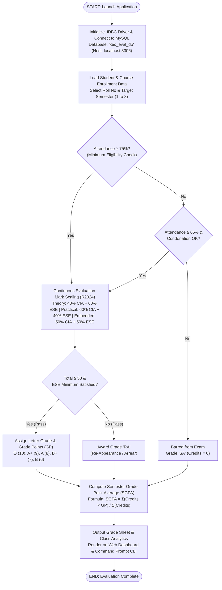

# KONGU ENGINEERING COLLEGE (AUTONOMOUS), PERUNDURAI - 638060
### TRANSFORM YOURSELF
## DEPARTMENT OF INFORMATION TECHNOLOGY
### 24ITT32 - PROGRAMMING IN JAVA
# INDIVIDUAL PROJECT ON ACADEMIC MANAGEMENT SYSTEM
## PROJECT REPORT

**Submitted by:**  
**VETRISELVAN K** (Roll No: **25ITR170**)  
**GitHub Repository:** [https://github.com/vetriselvank25it/Java-jdbc.git](https://github.com/vetriselvank25it/Java-jdbc.git)

---

## JAVA ASSIGNMENT

### AIM:
Development of Kongu Engineering College (R2024) Student Academic & Continuous Evaluation System using Java JDBC.

### OBJECTIVE:
Design and develop a database-driven Java application using JDBC to manage student records, perform incremental marks entry (Continuous Internal Assessments and End Semester Examinations), enforce attendance eligibility rules, and generate formal academic performance reports according to Kongu Engineering College (Autonomous) - Regulation 2024. System Requirements & Specifications.

---

## FLOW CHART:



---

## PROCEDURE:

1. **Load JDBC Driver:** Load the MySQL Connector/J driver to enable communication between the Java application and the MySQL database.
2. **Establish Connection:** Establish a connection to the `kec_eval_db` database running on the local MySQL server using `DriverManager.getConnection()`.
3. **Manage Students & Courses:** Store and retrieve student details, including roll number, name, department, and semester, along with course information such as course code, title, credits, and course type.
4. **Enroll & Track Attendance:** Enroll students in semester courses, record the number of classes held and attended, and calculate the attendance percentage.
5. **Verify Eligibility:** Verify examination eligibility based on attendance percentage. Students with 75% or above are eligible, those with 65%–74% require medical condonation verification, and those below 65% are marked as Shortage of Attendance (SA).
6. **Continuous Assessment Entry:** Record CIA-1, CIA-2, and assignment marks, and calculate the scaled internal assessment marks according to the specified theory and practical course weightages.
7. **ESE Assessment:** Record end-semester examination marks out of 100, verify the minimum passing requirements, and scale the marks according to the applicable theory and practical course categories.
8. **Final Grades & SGPA:** Calculate the total marks by combining scaled CIA and ESE marks. Assign letter grades and grade points according to the specified grading scale, marking students as RA if they fail the examination or score below the required passing mark.
9. **Reporting:** Generate student grade sheets, attendance shortage reports, and department-wise pass percentage reports. Display the results through the interactive web dashboard and the command prompt console.

---

## DATABASE SCHEMA:

### 1. STUDENTS TABLE:
```sql
CREATE TABLE students (
    roll_no VARCHAR(20) PRIMARY KEY,
    name VARCHAR(100) NOT NULL,
    department VARCHAR(20) NOT NULL,
    current_semester INT NOT NULL CHECK (current_semester BETWEEN 1 AND 8),
    created_at TIMESTAMP DEFAULT CURRENT_TIMESTAMP
);
```

### 2. COURSES TABLE:
```sql
CREATE TABLE courses (
    course_code VARCHAR(20) PRIMARY KEY,
    title VARCHAR(150) NOT NULL,
    credits DECIMAL(3, 1) NOT NULL CHECK (credits > 0),
    course_type ENUM('THEORY', 'PRACTICAL', 'EMBEDDED') NOT NULL,
    department VARCHAR(20) NOT NULL,
    semester INT NOT NULL CHECK (semester BETWEEN 1 AND 8)
);
```

### 3. ENROLLMENTS TABLE:
```sql
CREATE TABLE enrollments (
    enrollment_id INT AUTO_INCREMENT PRIMARY KEY,
    roll_no VARCHAR(20) NOT NULL,
    course_code VARCHAR(20) NOT NULL,
    semester INT NOT NULL,
    classes_held INT DEFAULT 0,
    classes_attended INT DEFAULT 0,
    medical_condonation BOOLEAN DEFAULT FALSE,
    condonation_reason VARCHAR(255),
    FOREIGN KEY (roll_no) REFERENCES students(roll_no) ON DELETE CASCADE,
    FOREIGN KEY (course_code) REFERENCES courses(course_code) ON DELETE CASCADE,
    UNIQUE (roll_no, course_code, semester)
);
```

### 4. ASSESSMENT MARKS TABLE:
```sql
CREATE TABLE assessment_marks (
    mark_id INT AUTO_INCREMENT PRIMARY KEY,
    enrollment_id INT UNIQUE NOT NULL,
    cia_test1 DECIMAL(5, 2) DEFAULT NULL,
    cia_test2 DECIMAL(5, 2) DEFAULT NULL,
    assignment_quiz_lab DECIMAL(5, 2) DEFAULT NULL,
    ese_marks DECIMAL(5, 2) DEFAULT NULL,
    is_ese_absent BOOLEAN DEFAULT FALSE,
    computed_cia DECIMAL(5, 2) DEFAULT NULL,
    computed_ese DECIMAL(5, 2) DEFAULT NULL,
    total_marks DECIMAL(5, 2) DEFAULT NULL,
    letter_grade VARCHAR(5) DEFAULT NULL,
    grade_point INT DEFAULT NULL,
    result_status VARCHAR(30) DEFAULT NULL,
    FOREIGN KEY (enrollment_id) REFERENCES enrollments(enrollment_id) ON DELETE CASCADE
);
```

---

## OUTPUT SCREENSHOTS & EXECUTION PROOFS:

### 1. Main Menu:
Console menu interface with options for registration, catalog, enrollments, attendance, phased marks entry, grade sheet, defaulters list, summary, and exit.

### 2. Student & Course Management:
- **Student Registration:** Roll Number `25ITR170`, Full Name `VETRISELVAN K`, Department `IT`, Semester `3`.
- **Course Catalog Management:** Code `24ITR11`, Title `Game Development`, Credits `3.0`, Type `EMBEDDED`.
- **Course Enrollment & Attendance Tracking:** Roll No `25ITR170` enrolled into `24ITP32` (Object Oriented Programming with Java Lab, PRACTICAL, Credits: 1.5).

### 3. Incremental Marks Entry ("Then and Now"):
- **Phase 1 (Mid-Semester):** CIA 1 Marks (92), CIA 2 Marks (93) recorded for student `25ITL187`, course `24ITC31`.
- **Phase 2 (End of Semester - CIA):** Assignment / Quiz / Lab Evaluation Marks (90) recorded.
- **Phase 3 (Post Semester ESE):** End Semester Examination (ESE) mark entered or flagged absent (`AB`).

### 4. Attendance & Grading Rules:
- **Attendance Filter:** Defaulter and condonation report detailing attendance percentages, conditional medical condonations, and barred (`SA`) candidates.

### 5. Student Semester Mark Sheet:
- Complete grade sheet with scaled CIA, scaled ESE, Letter Grades, SGPA (`10.00 / 10.00`), and Equivalent Percentage (`100.00%`).

### 6. Department Wise Class Performance & Result Summary:
- Consolidated department metrics across CSE, ECE, and IT including pass percentages and average SGPAs.

---

## RESULT:

Thus, the Student Academic and Continuous Evaluation System for Kongu Engineering College (Autonomous) Regulation 2024 was successfully designed, developed, and tested using Java (JDBC) and MySQL. The system accurately automates the calculation of Continuous Internal Assessments (CIA), End Semester Examinations (ESE), Letter Grades, Attendance Eligibility, and Semester Grade Point Average (SGPA).

---

## REFERENCES:

1. Oracle, Java SE Documentation – JDBC Overview and Architecture.  
   [https://docs.oracle.com/javase/8/docs/technotes/guides/jdbc/](https://docs.oracle.com/javase/8/docs/technotes/guides/jdbc/)
2. Oracle, Java SE API – HttpServer.  
   [https://docs.oracle.com/en/java/javase/17/docs/api/jdk.httpserver/com/sun/net/httpserver/HttpServer.html](https://docs.oracle.com/en/java/javase/17/docs/api/jdk.httpserver/com/sun/net/httpserver/HttpServer.html)
3. Oracle, MySQL 8.0 Reference Manual.  
   [https://dev.mysql.com/doc/refman/8.0/en/](https://dev.mysql.com/doc/refman/8.0/en/)
4. Oracle, MySQL Connector/J Developer Guide.  
   [https://dev.mysql.com/doc/connector-j/8.0/en/](https://dev.mysql.com/doc/connector-j/8.0/en/)
5. University Grants Commission, Guidelines for Choice Based Credit System (CBCS).  
   [https://www.ugc.gov.in/pdfnews/8023719_Guidelines-for-CBCS.pdf](https://www.ugc.gov.in/pdfnews/8023719_Guidelines-for-CBCS.pdf)
6. Chart.js, Chart.js Documentation.  
   [https://www.chartjs.org/docs/latest/](https://www.chartjs.org/docs/latest/)
7. Tailwind CSS, Tailwind CSS Documentation.  
   [https://tailwindcss.com/docs](https://tailwindcss.com/docs)
8. GeeksforGeeks, Establishing JDBC Connection in Java.  
   [https://www.geeksforgeeks.org/establishing-jdbc-connection-in-java/](https://www.geeksforgeeks.org/establishing-jdbc-connection-in-java/)
9. YouTube, Java JDBC with MySQL Tutorial Videos.  
   [https://www.youtube.com/results?search_query=Java+JDBC+MySQL+tutorial](https://www.youtube.com/results?search_query=Java+JDBC+MySQL+tutorial)
10. Anthropic, Claude AI Assistant (used for project ideas and guidance).  
    [https://claude.ai/](https://claude.ai/)

---

## GITHUB REPOSITORY:
**LINK:** [https://github.com/vetriselvank25it/Java-jdbc.git](https://github.com/vetriselvank25it/Java-jdbc.git)
